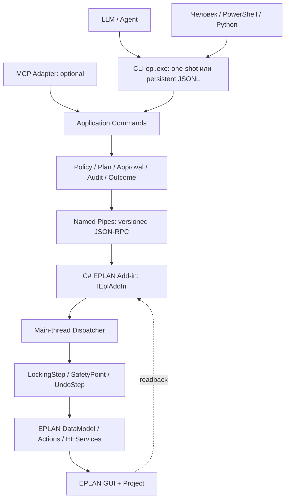

# Концепция EPLAN Automation: CLI, Add-in, MCP и прямое управление LLM

> **Статус:** исследовательская концепция / варианты для проверки, не утверждённая замена действующей архитектуры.  
> **Дата фиксации:** 2026-11-18.  
> **Репозиторий:** независимый `boogy777-lgtm/eplan-mcp`.  
> **Назначение:** сохранить обсуждённые идеи, альтернативы, инварианты, риски и план экспериментов.  
> **Изменения кода:** этот документ не изменяет текущие протоколы, безопасность и API.

## 1. Цель

Дать LLM «руки и глаза» для работы с **уже запущенным EPLAN Electric P8 / Pro Panel**: находить объекты, читать свойства и связи, выполнять инженерные изменения, наблюдать их результат в GUI и получать компактную машиночитаемую обратную связь.

Критерии:
- минимальная стоимость контекста и число вызовов на инженерную задачу;
- полный доступ к применимым возможностям EPLAN API без ручной регистрации отдельного MCP Tool для каждого метода;
- один источник бизнес-операций для CLI, MCP, Python и GUI;
- контролируемая запись с подтверждением, ревизией/планом, readback, аудитом и состоянием неопределённого исхода;
- независимое развитие форка; upstream — источник для анализа, без автоматической синхронизации или отправки PR.

## 2. Изученные архитектурные варианты

| Вариант | Модель | Плюсы | Риски / ограничения | Статус |
|---|---|---|---|---|
| A. 199 MCP Tools (Canary) | Python MCP → EPLAN Remoting / C# scripts | Готовая предметная поверхность, быстрый прототип | Большой каталог; достоверность результатов и обработка ошибок требуют испытаний | Сравнить |
| B. MCP Discovery | `search/describe/call` над скрытыми инструментами | Меньше начальный контекст | Дополнительные вызовы поиска | Сравнить |
| C. UTCP Python | UTCP Manual + discovery/call → адаптер EPLAN | Единые декларативные описания и разные транспорты | Дополнительный слой, не решает транзакции EPLAN | Эксперимент |
| D. Universal Invoke | API Registry → `invoke(id,target,args)` → typed dispatcher | Один механизм для длинного хвоста API | Типы, версии, побочные эффекты, перегрузки, безопасность | Эксперимент |
| E. Roslyn Script Host | `eplan_execute(code)` → C# внутри EPLAN | LLM напрямую пишет типизированные вызовы, легко объединять шаги | Произвольный код в процессе EPLAN, отсутствие полноценной sandbox | Только ограниченные испытания |
| F. **CLI-first + Add-in-backed** | LLM → CLI → Named Pipes → C# Add-in → EPLAN API | Универсальный интерфейс для людей/агентов; независим от MCP | Нужен локальный агент с доступом к CLI; IPC и контроль записи | **Основная гипотеза** |

Выбор F не отменяет A–E: MCP и UTCP могут быть адаптерами к тому же прикладному контракту; универсальный invoke и C# Script Host могут быть отдельными ограниченными режимами.

## 3. Целевая топология (гипотеза)



**Граница ответственности:** CLI/MCP — транспорт и интерфейс; прикладные команды — семантика; Bridge — диспетчеризация и безопасное взаимодействие с EPLAN API; Skills — знания и процедуры, а не исполнитель или источник полномочий.

### 3.1. Add-in как мост для CLI

- `IEplAddIn` загружается в `EPLAN.exe`, запускает IPC-сервер при инициализации GUI.
- `epl.exe` — отдельный CLI-процесс (предпочтительно Rust; альтернатива — оставить существующий .NET Host).
- Windows Named Pipes: локальный двунаправленный канал; транспорт JSON-RPC 2.0 с `Content-Length` framing.
- Идентификация экземпляра EPLAN, handshake и согласование версии контракта.
- Вызовы EPLAN API выполняются через диспетчер главного потока. В одном экземпляре операции сериализуются.
- Bridge возвращает DTO, ошибки, сообщения EPLAN и фактические результаты. Не передавать .NET-объекты или указатели через IPC.

Существующий код уже содержит основу: `EplanAddIn`, `BridgeServer`, `BridgeClient`, `PipeBridgeDiscovery`, `EplanDispatcher`, `OperationRouter`, `TransactionRunner`. **Не создавать параллельный IPC без доказанного пробела.**

### 3.2. CLI как «руки» LLM

Предлагаемый (ещё не реализованный) интерфейс:

```text
epl status
epl project list --json
epl page get --project Cabinet --name "=A1+S1/10" --json
epl search "page property"
epl describe <operation-id>
epl query <operation-id> --args-file request.json
epl plan <operation-id> --args-file request.json
epl apply <plan-id>
epl result <request-id>
epl shell --jsonl
```

Режимы:
- **One-shot** — процесс на одну команду, подходит для скриптов и тестов.
- **Persistent** — один процесс и соединение, запросы/ответы JSONL через stdin/stdout, полезно для многократных действий агента.
- **MCP** — адаптер поверх тех же application commands, без повторной реализации предметной логики.

CLI доступен LLM только при наличии локального исполнителя команд на машине с EPLAN; веб-чат сам по себе не получает доступ к локальному процессу.

### 3.3. Контракт ответа и токен-эффективность

Нужен компактный ответ по умолчанию, подробности — по запросу:

```json
{
  "requestId": "r-123",
  "ok": true,
  "execution": "committed",
  "changed": 4,
  "verified": 4,
  "revision": "r42",
  "warnings": []
}
```

Это **предлагаемая** схема, а не существующий ответ. Для чтения: минимальные DTO + `nextCursor`; для ошибок: `reason`, `retryable`, `execution`, `correlationId`, короткая подсказка и отдельный доступ к деталям. Поддерживать `concise/detailed`, пагинацию и дифф изменений.

## 4. Skills вместо огромного описания EPLAN API

Предлагаемые домены:
- `eplan-core`: объекты, структура проекта, идентичность;
- `eplan-schematic`: страницы, размещение, соединения;
- `eplan-plc`: адресация PLC и I/O;
- `eplan-parts`: изделия, макросы, базы данных;
- `eplan-panel-3d`: Pro Panel, координаты и размещение;
- `eplan-reports`: проверки, отчёты, экспорт;
- `eplan-api-explorer`: поиск сигнатур и экспериментальные возможности.

`SKILL.md` содержит короткий маршрут, `references/` — детали, примеры и инварианты. **Тысячи сигнатур не копировать в Skills**: источник истины — версионированный машиночитаемый API Registry, доступный через search/get и при необходимости MCP Resources. Поддержку Skills конкретными MCP-клиентами проверять отдельно.

## 5. Capability Registry + Universal Invoke

Возможный интерфейс:

```json
{
  "id": "cap_<stable-hash>",
  "target": {
    "kind": "Page",
    "project": "Cabinet",
    "name": "=A1+S1/10"
  },
  "args": {"value": "=A1+S1/11"},
  "mode": "preview"
}
```

**ID** должен соответствовать точной перегрузке и операции get/set, а не порядковому номеру строки в БД. Вычислять из нормализованной сигнатуры и версии API; хранить полный XML documentation ID и `O:` group ID для прослеживаемости. LLM выбирает ID из результатов поиска, а не придумывает.

Три слоя каталога:
1. **API Registry**: DLL metadata + IntelliSense XML; типы, методы, параметры, версии, сигнатуры.
2. **Semantic Dictionary**: русские/английские термины, синонимы, инженерные задачи.
3. **Capability Policy/Evidence**: read/write/destructive/external, поддержка, лицензии, версии, реальная проверка, условия отмены.

Для поиска сначала переиспользовать существующий встроенный сжатый `ApiIndex`; SQLite FTS5 добавлять лишь при измеренном недостатке семантического поиска. Существуют `eplan_api_search`, `eplan_api_get`, `eplan_api_try`, `catalog/`, `ApiTryDispatch.g.cs` и генерация каталогов. Не дублировать их.

**Предпочтительный исполнитель** — сгенерированная таблица типизированных делегатов, а не произвольная Reflection по переданным LLM именам. Универсальные этапы: resolve target → validate signature/args → authorize → plan → approve → execute → readback → outcome. Сложные инженерные операции сохраняют высокоуровневые use cases.

Ограничения: нельзя считать каталог автоматически разрешением на исполнение. Неизвестные побочные эффекты, опасные методы, неподдерживаемые `ref/out`, указатели, делегаты и внешние эффекты блокируются до отдельной проверки. Объекты передаются через локаторы или проверяемые временные handles, не через указатели.

## 6. Plan B: C# Code Execution

Вариант `eplan_execute(code)`: LLM формирует C#; компиляция Roslyn → диагностика → выполнение в контексте EPLAN → JSON/readback. Позволяет объединять несколько API-вызовов в одном сценарии.

Но **C# внутри EPLAN имеет полномочия процесса EPLAN**. `compile_only` не доказывает безопасность; `dry_run` нельзя доверять как изоляции произвольного кода. Для тестов использовать только изолированную копию проекта и доверенный код. Не открывать произвольный `execute_csharp` для рабочих проектов без отдельной модели угроз и исполняемой политики.

## 7. Свойства EPLAN и синтаксис

Разделять разные грамматики, не смешивая их в универсальный parser `[]`:
- числовые ID и индексированные свойства: `11090[1]` (результат свойства блока), `11091[1]` (формат);
- C# Property Access: `page.Properties[Properties.Page.PAGE_BLOCK_VALUE, 1]` и `PropertyValue.Indexes`;
- Block Properties: композиция свойств, косвенные ссылки, разделители, условия, языки, замены;
- переменные заполнителей `<Имя [24,1]>`;
- конфигурации импорта/экспорта `[#3]`, `[1!#189]`;
- группировка в обозначениях кабелей и структурные обозначения страниц.

Полная грамматика сериализованного значения `PAGE_BLOCK_FORMAT[1]` **не установлена**. Проверка: создать набор форматов через GUI, прочитать через API, сравнить представление и эффекты; не выводить грамматику из визуального синтаксиса.

Официальные источники для дальнейшей проверки:
- [Реестр свойств EPLAN 2026](https://www.eplan.help/ru-ru/Infoportal/Content/Plattform/2026/Content/htm/properties_o_main.htm)
- [Принцип свойств блока](https://www.eplan.help/ru-ru/Infoportal/Content/Plattform/2026/Content/htm/blockproperties_k_prinzip.htm)
- [EPLAN API: PropertyValue](https://www.eplan.help/en-US/infoportal/content/api/2026/Eplan.EplApi.DataModelu~Eplan.EplApi.DataModel.PropertyValue.html)

## 8. Безопасность и корректность

1. **Чтение и запись различать по фактическим эффектам**, а не по имени метода. Некоторые проверки EPLAN изменяют сообщения проекта.
2. **Preview → Approval → Apply → Verify**. Подтверждение инженера — в доверенном EPLAN/Workbench UI, привязано к хешу плана и актуальному состоянию проекта.
3. **Сериализация по экземпляру EPLAN** и повторная проверка объекта перед записью.
4. **Transaction/Undo**: `LockingStep`, `SafetyPoint`, `UndoStep` — использовать по проверенным правилам и с учётом границ применимости.
5. **Неопределённый исход**: `not_started | rolled_back | committed | unknown`. При `unknown` не повторять запись; выяснить результат и при необходимости приостановить новые записи.
6. **Named Pipes ACL** защищает от других Windows-пользователей, но не от недоверенного процесса под той же учётной записью. Политика Host не является достаточной защитой от прямого подключения к Bridge. Нужно проверить авторизацию на границе Bridge и отдельно определить модель доверия.
7. **Аудит и диагностика**: корреляционный ID, сообщения EPLAN, изменение до/после, версия, время, проверка хеш-цепочки.
8. **Никакой автоматической записи в рабочий проект** по одной лишь инструкции модели.

## 9. Эксперименты и критерии выбора

Сравнить на одинаковых задачах и одинаковой модели:
- Canary `full` (199 заявленных инструментов);
- Canary `discovery` (13);
- UTCP Python поверх существующего MCP;
- CLI + Add-in;
- Universal Invoke (только разрешённые возможности);
- Roslyn Script Host (только изолированный эксперимент).

Метрики: токены контекста, правильный первый выбор, число вызовов, latency, ошибки аргументов, фактический readback, rollback/unknown, усилия для добавления N+1 операции.

Минимальные тестовые задачи: список проектов; чтение свойств страницы/устройства; создание страницы; вставка макроса; изменение PLC-адреса на scratch-копии. Дополнительно проверить обрыв pipe до/после commit, busy GUI, модальные окна, повтор запроса, две одновременно запущенные EPLAN-сессии.

**Порядок прототипа:** status → project list → page get → property get → property set (preview/approval/readback) → persistent JSONL → MCP adapter. До переноса остальных инструментов доказать, что единый CLI/IPC-контракт работает.

## 10. Архитектурные инварианты N+1

- Новый клиент (CLI/MCP/Python/GUI) **не** создаёт отдельную реализацию EPLAN-операции.
- Новый метод того же класса добавляется в каталог/dispatch table, а не порождает новый транспорт и новый Policy Engine.
- Новый класс поведения, не покрытый существующими инвариантами, требует отдельного ADR и теста.
- При выборе новой архитектуры измерять **стоимость и надёжность завершённой инженерной задачи**, а не только число Tools.
- Изменения архитектуры не делать в рамках перевода документации; отдельно отложить миграцию Rust и замену Host.

## 11. Решения, вопросы, статус

**Зафиксировано как направление обсуждения:** CLI-first, Add-in-backed, MCP-optional; Named Pipes как предпочтительный локальный IPC; Skills для инженерных знаний; повторное использование текущего API-каталога; независимое развитие форка.

**Не утверждено:** замена текущего .NET Host на Rust; удаление 121 существующего Tool; перенос 199 инструментов Canary; добавление UTCP; разрешение произвольного C#; выбор SQLite; новая схема IPC; запуск операций на рабочем проекте.

**Открытые вопросы:** конкретная лицензия EPLAN API Extension и целевые версии; как доверять CLI-клиенту при локальном IPC; какие use cases оставить высокоуровневыми; контракт persistent CLI; критерии миграции; доступность реальных EPLAN интеграционных испытаний.

## 12. Ссылки и происхождение идей

- [Наш EPLAN MCP](https://github.com/boogy777-lgtm/eplan-mcp) — действующая реализация Host/Bridge и API Registry.
- [Canary-ECAD/eplan-mcp](https://github.com/Canary-ECAD/eplan-mcp) — 199 заявленных Tools, Discovery и C#-сценарии (проверять по актуальному исходному коду).
- [UTCP Python](https://github.com/universal-tool-calling-protocol/python-utcp) и [UTCP-MCP](https://github.com/universal-tool-calling-protocol/utcp-mcp).
- [ADR-0002](../adr/0002-host-bridge-process-model.md), [ADR-0003](../adr/0003-ipc-named-pipe-json-rpc.md), [ADR-0006](../adr/0006-tool-surface-design.md), [ADR-0008](../adr/0008-data-locations-and-instance-discovery.md), [ADR-0010](../adr/0010-write-outcomes.md).
- [Каталог EPLAN API](../../catalog/README.md), [матрица покрытия](../eplan/api-coverage.md), [инструменты](../tools/README.md).

Документ сохраняет архитектурные гипотезы, а не объявляет их реализованными или испытанными.
